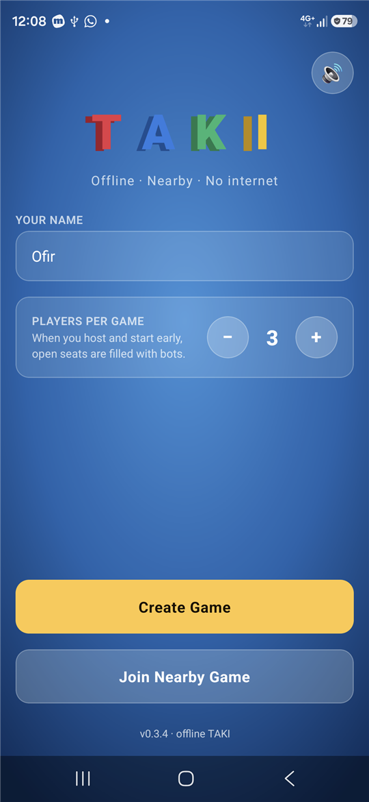
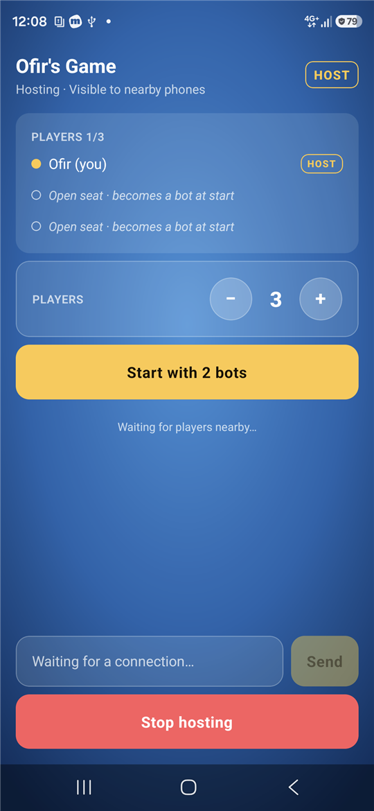
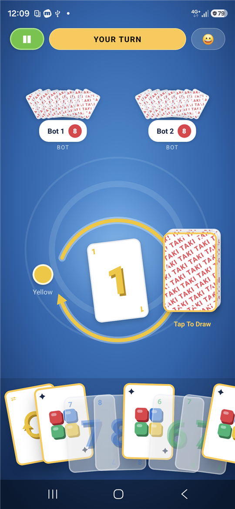
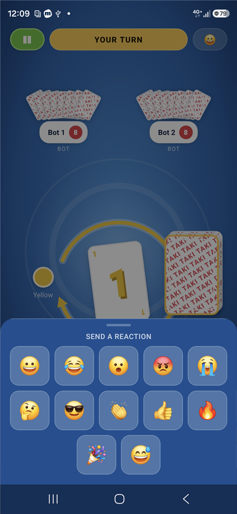
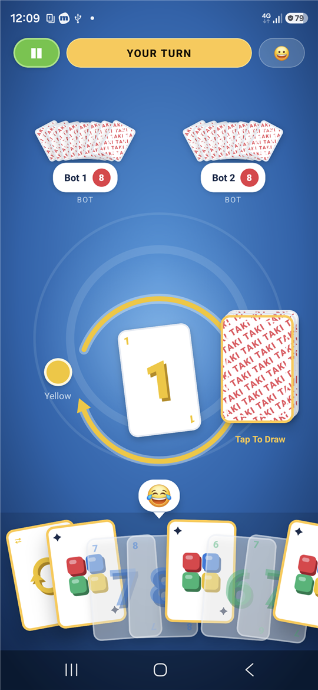

# Offline TAKI

**Play TAKI with the people sitting next to you. No internet, no server, no account.**

One phone hosts, the others find it and join over Bluetooth. It works in airplane mode, on a
train through a tunnel, at a cabin with no signal, or in a classroom with no Wi‑Fi. Empty seats
are filled with bots, so two people can still play a four-player game.

<p align="center">
  
  
  
  
  
</p>

---

## Why this exists

The idea came from a long flight. Four people, four phones, a deck of cards nobody packed, and a
cabin where every multiplayer game on the store wanted an internet connection, an account, or
both. The phones were sitting a metre apart; they just had no way to talk to each other.

Offline TAKI is the game that should have been on those phones:

- It needs **nothing but the phones themselves**. No Wi‑Fi network, no mobile data, no hotspot
  to configure, no cloud. Airplane mode with Bluetooth switched back on is enough.
- It is **as easy as a real deck**: one person taps *Create Game*, everyone else taps *Join
  Nearby Game* and picks the table. No IP addresses, codes, pairing dialogs or sign-ups.
- It is **honest with your data**: there is no account, no analytics, no ads and no server.
  Nothing leaves the phones, and your cards exist only on your own phone.
- It **doesn't need a full table**: open seats are taken by bots, so a short-handed family or a
  single player can still play a proper round.

## What makes it different

| | Offline TAKI | Typical store card game |
|---|---|---|
| Internet required | No | Yes |
| Account or login | No | Usually |
| Ads, purchases, tracking | None | Common |
| How players connect | Tap *Join Nearby Game*, pick the table | Online lobby or invite codes |
| Works in airplane mode | Yes, with Bluetooth on | No |
| Bots to fill empty seats | Yes | Sometimes |
| Where your hand is stored | Only on your phone | On a server |
| Rules you can change | House-rule switches in code, open source | Fixed |

## Features

- **Lobby**: pick the number of seats (2 to 8), see who is at the table, chat, start when
  ready. Open seats become bots at start.
- **The classic rules**: colour, number and symbol matching; Stop, Plus, Change Direction,
  Change Color, and TAKI sequences where you chain cards of one colour and close explicitly.
  A Plus cannot be your last card. With two players a Change Direction acts as a Stop.
- **A real table**: blue felt, players seated around the top with fanned card backs and name
  plates, a rotated discard stack with direction arrows, and your hand fanned at the bottom with
  playable cards raised and highlighted.
- **Bots** that play sensibly (favour the colour they hold most of, keep wilds for later, never
  end on a Plus) with a moment's thinking time so turns stay readable.
- **Sound effects**: card snaps, a chime when it is your turn, a rising arpeggio for TAKI, a
  fanfare when you win. Synthesised, licence-free and mutable with one tap.
- **Emoji reactions**: twelve quick reactions that pop up as speech bubbles over the sender's
  seat on every phone.
- **Resilient links**: a phone that loses Bluetooth for a moment reconnects and gets its seat
  and cards back; the game continues for everyone else meanwhile.
- **Private hands by design**: the host owns the game and sends each phone only what that
  player may see. Other players' cards never cross the air.

## How it works, briefly

- **Transport**: Google Nearby Connections, which uses Bluetooth and Wi‑Fi Direct and runs
  entirely on the device. It sits behind a small transport interface so that a Bluetooth Low
  Energy transport (for iPhones and phones without Google services) can be added later.
- **Host-authoritative engine**: the hosting phone runs the rules engine. Phones send actions
  (play this card, draw, choose a colour, close TAKI); the host validates them and broadcasts
  numbered events. Every event is redacted per recipient, and a client that misses one asks for
  the gap or a snapshot.
- **Pure engine**: the rules are plain TypeScript with no UI or networking imports. One handler
  per card kind means a new card (Plus 2, Super TAKI, King) is one handler and its deck entries.
- **Tests**: 180 unit tests, including random full-game simulations and complete games played
  across simulated phones with every phone's view checked against the host's truth after each move.

The full design, including the evaluation of Bluetooth, Wi‑Fi Direct, Nearby Connections and
Multipeer Connectivity and the reasons behind each decision, is in
[docs/PHASE1-ARCHITECTURE.md](docs/PHASE1-ARCHITECTURE.md).

## Getting started as a player

1. Install `OfflineTaki-<version>-release.apk` from the `dist` folder on every phone (copy the
   file over and open it; allow installing from that source when Android asks). Android 7 or
   newer with Bluetooth and Google Play Services.
2. Open the app, enter a name, and allow the *Nearby devices* permission (older Android versions
   ask for *Location* instead, and need the system Location toggle on; the app tells you).
3. Airplane mode is fine. Turn Bluetooth back on; Wi‑Fi may stay off.
4. One phone: set the number of players and tap **Create Game**. The others: **Join Nearby
   Game** and tap the table. The host taps **Start** (or **Start with N bots**).
5. Play. The banner tells you when it is your turn; muted cards cannot be played.

Step-by-step test instructions, permissions by Android version and troubleshooting are in
[docs/BUILD.md](docs/BUILD.md).

## Building from source

Requirements: Node.js 22+, JDK 17, Android SDK (platform 37, build-tools 37, NDK 28.2). No
Android Studio needed. Networking only works on real phones, not emulators.

```powershell
npm install
build-apk.cmd                 # release APK -> dist\OfflineTaki-<version>-release.apk
npm test                      # 180 tests
npm run typecheck && npm run lint
```

Signing, the standalone-APK guarantees, the icon and sound generators, and the full acceptance
test live in [docs/BUILD.md](docs/BUILD.md).

## Project layout

```
android/                       standard Gradle project + Kotlin Nearby Connections module
src/
  game/                        pure rules engine: cards, rules/handlers, engine, state, projection
  networking/
    transport/                 NearbyTransport interface, Nearby implementation, in-memory test transport
    protocol/                  message types, zod schemas, codec, reactions
    session/                   shared session state and core
    host/                      GameHost: engine owner, event log, bots
    client/                    GameClient: view reducer, resync
  platform/                    permissions, radio state, foreground service, keep-awake, sounds
  storage/                     player profile and settings
  app/ screens/ components/ hooks/   React Native UI
scripts/                       generate-sounds.js, generate-icon.js, render-icon-pngs.ps1, capture-screenshots.ps1
docs/                          architecture, build guide, screenshots
```

## Status and roadmap

Playable today on Android: lobby, bots, full rules, the table UI, sounds, reactions, reconnect.
Verified between two phones in airplane mode.

Next:

1. Reliability pass: heartbeats, turn timeouts for absent players, automatic rejoin when the
   radio comes back, surviving an app restart mid-game.
2. iOS: a Bluetooth Low Energy transport on both platforms so iPhones and Androids can share a
   table, and Multipeer Connectivity for all-iPhone tables.
3. More cards and house rules: Plus 2, Super TAKI, King, Break Plus Three.
4. Hebrew and right-to-left layout, statistics, custom avatars.

## Disclaimer

TAKI is a card game published by Shafir Games. This is an unofficial, non-commercial fan
project for playing with friends offline; it is not affiliated with or endorsed by the
publisher.
